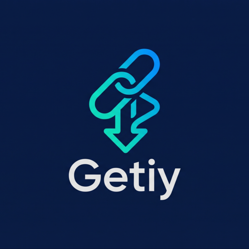
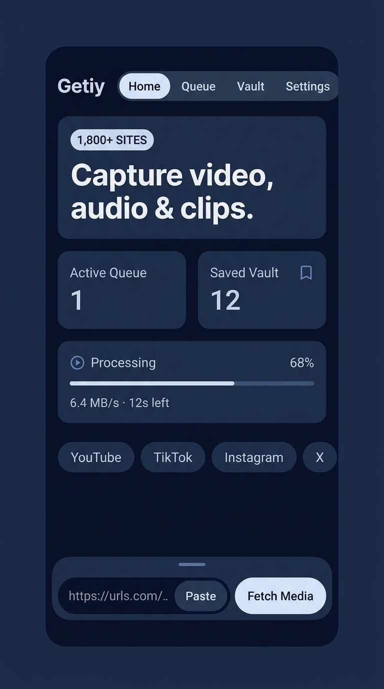
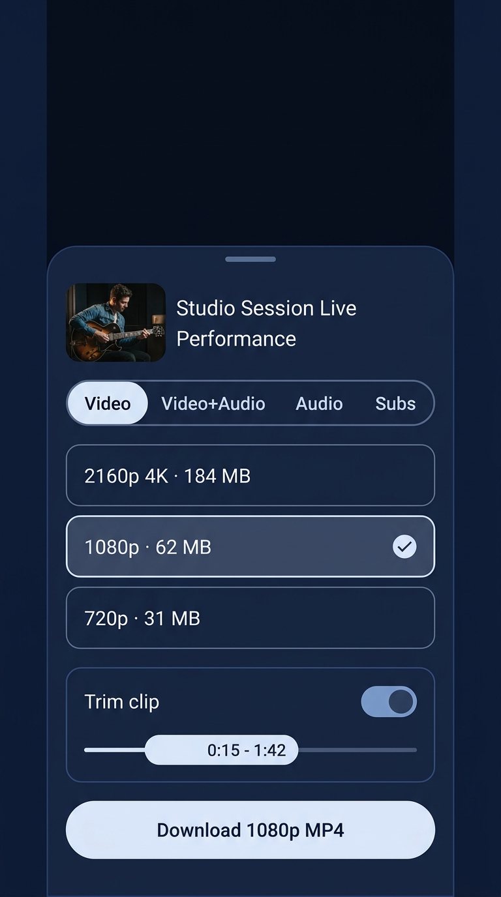
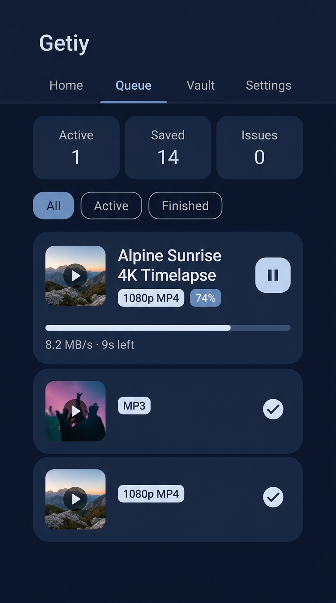
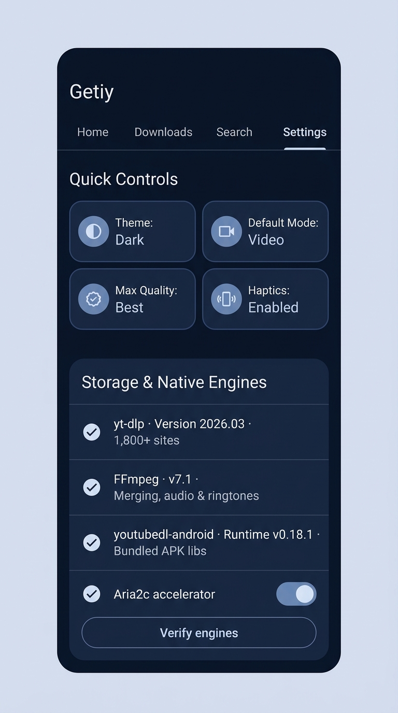

<p align="center">
  
</p>

<h1 align="center">Getiy</h1>

<p align="center">
  <strong>Paste a link. Get the file.</strong><br/>
  A fast, private, native Android media downloader powered by <code>yt-dlp</code>, <code>FFmpeg</code>, <code>youtubedl-android</code>, and <code>Aria2c</code>.
</p>

<p align="center">
  <a href="LICENSE"></a>
  
  
  
  
</p>

---

## Screenshots

<p align="center">
  <table>
    <tr>
      <td align="center" width="25%">
        <br/>
        <sub><strong>Home & Live Fetch</strong></sub>
      </td>
      <td align="center" width="25%">
        <br/>
        <sub><strong>Format Picker & Trim</strong></sub>
      </td>
      <td align="center" width="25%">
        <br/>
        <sub><strong>Queue & Real-Time Progress</strong></sub>
      </td>
      <td align="center" width="25%">
        <br/>
        <sub><strong>Settings & Native Engines</strong></sub>
      </td>
    </tr>
  </table>
</p>

---

## Features

- **1,800+ Supported Sites** — Powered natively on-device by `yt-dlp`, supporting YouTube, TikTok, Instagram, X/Twitter, Reddit, Vimeo, SoundCloud, Twitch, and hundreds more.
- **High-Resolution Video & Lossless Audio** — Save up to 4K/60fps video (`MP4`, `MKV`, `WEBM`) or extract clean audio (`MP3`, `M4A`, `Opus`, `FLAC`) with automatic `FFmpeg` stream muxing, artwork embedding, and metadata tagging.
- **Inline Clip Trimming & Ringtone Maker** — Select exact start/end timestamps before downloading or convert any saved audio clip directly into a ringtone.
- **Real-Time Progress Tracking** — Smooth Material 3 `LinearProgressIndicator` status cards across the Home screen, Fetch dock, and Queue with live download speed, ETA, and byte counts.
- **Playlist & Batch Downloads** — Inspect playlists, pick individual entries, and manage concurrent downloads with pause, resume, retry, and foreground notification controls.
- **Aria2c Multi-Connection Accelerator** — Optional `Aria2c` toggle in Settings to accelerate large media transfers.
- **Android System Integrations** — Share links straight from any browser or social app via Android's `ACTION_SEND` sheet, or trigger quick clipboard fetches from the **Quick Settings Tile**.
- **Built-in Media Library & Audio Player** — Browse, filter, preview, share, and play your saved downloads offline with a foreground media playback service.
- **Private & Local-Only** — Zero ads, zero analytics, zero cloud accounts, and zero remote proxy servers. Everything runs locally on your device.

---

## Bundled Native Engines

All media extraction, muxing, and download engines are bundled natively in the APK — no remote code execution or external server dependencies required:

| Engine | Version / Source | Purpose |
| :--- | :--- | :--- |
| **[youtubedl-android](https://github.com/yausername/youtubedl-android)** | `0.18.1` | Native Android runtime wrapper for `yt-dlp`, `FFmpeg`, and `Aria2c` |
| **[yt-dlp](https://github.com/yt-dlp/yt-dlp)** | Bundled + in-app updater | Media metadata extraction and format resolution across 1,800+ sites |
| **[FFmpeg](https://github.com/ffmpeg/ffmpeg)** | Bundled native binaries | High-speed video/audio muxing, transcoding, clip trimming, and thumbnail embedding |
| **[Aria2c](https://github.com/aria2/aria2)** | Bundled native binary | Optional multi-connection download acceleration |

You can inspect live binary status, verify all engines, or update `yt-dlp` directly from **Settings → Engines**.

---

## Tech Stack

- **Language:** Kotlin
- **UI:** Jetpack Compose + Material Design 3 (adaptive phone & tablet layouts, edge-to-edge)
- **Persistence:** Room (local download history & queue) + Jetpack DataStore (user preferences)
- **Concurrency:** Kotlin Coroutines & `StateFlow`
- **Networking & Images:** OkHttp + Coil
- **Architecture:** MVVM with clean `GetiyEngine` abstraction and foreground `DownloadService` / `AudioPlaybackService`

---

## Building from Source

### Prerequisites

- **JDK 11+**
- **Android Studio** (Ladybug or newer recommended) or Android SDK CLI (`compileSdk 36`, `minSdk 24`)

### Clone & Build

```bash
git clone https://github.com/tpxlegend/Getiy.git
cd Getiy

# Build a debug APK
./gradlew assembleDebug

# Run unit & Robolectric tests
./gradlew :app:testDebugUnitTest
```

The debug APK is generated at:

```text
app/build/outputs/apk/debug/app-debug.apk
```

### Signed Release Build

Configure your signing credentials via environment variables before running `assembleRelease` or `bundleRelease`:

```bash
export KEYSTORE_PATH="/path/to/your-upload-key.jks"
export STORE_PASSWORD="your-store-password"
export KEY_PASSWORD="your-key-password"

./gradlew assembleRelease
```

- **Application ID:** `com.getiy.tpxstudio`
- **Reproducible / F-Droid Friendly:** Google Play dependency metadata (`dependenciesInfo`) is disabled in both APK and AAB builds.

---

## Permissions & Privacy

Getiy requests only the minimal permissions needed for on-device media downloading:

| Permission | Reason |
| :--- | :--- |
| `INTERNET` / `ACCESS_NETWORK_STATE` | Fetch media metadata and download streams directly from source URLs |
| `POST_NOTIFICATIONS` *(runtime, Android 13+)* | Show live download progress and completion notifications |
| `FOREGROUND_SERVICE_DATA_SYNC` / `FOREGROUND_SERVICE_MEDIA_PLAYBACK` | Keep active downloads and offline audio playback running reliably in the background |
| `WRITE_EXTERNAL_STORAGE` *(Android 9 and lower only)* | Save files to public `Downloads/Getiy` on legacy Android devices (`maxSdkVersion="28"`) |
| `WRITE_SETTINGS` *(optional)* | Set a trimmed audio clip as your device ringtone when explicitly triggered |

- **No Advertising ID (`AD_ID` explicitly stripped in manifest).**
- **No trackers, crash telemetry, or third-party analytics.**
- **Local downloads and preferences are excluded from cloud backup (`allowBackup="false"`).**

---

## Legal Notice

Getiy is a general-purpose media download tool intended for personal archival, Creative Commons, public-domain, and user-owned content. Users are solely responsible for respecting copyright laws and the terms of service of the websites they access.

---

## Open-Source License

Getiy is free and open-source software licensed under the **GNU General Public License v3.0 (GPL-3.0)**.
See the [LICENSE](LICENSE) file for the complete license text.
